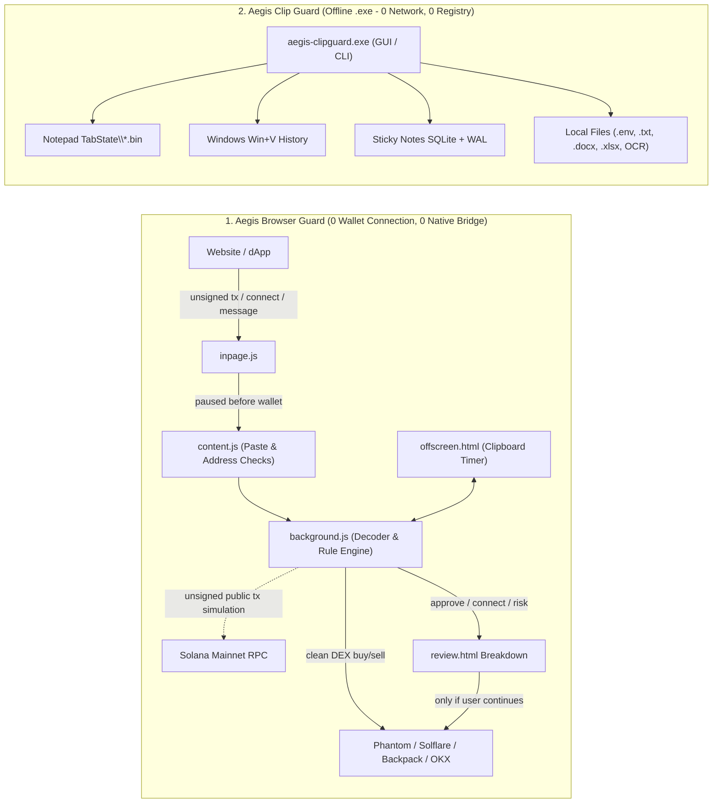

# Aegis Wallet Shield (`$AEGIS`)

**Zero-Connection Solana Transaction Decoder, 30s Clipboard Cleaner & Offline Windows 11 Notepad Cache Wiper**

[](LICENSE)
[-10b981.svg)](docs/SECURITY.md)
[-0ea5e9.svg)](docs/NETWORK.md)
[](docs/BUILD.md)

[**Why I Built This**](docs/NARRATIVE.md) | [**Quick Install**](docs/INSTALL.md) | [**Agent Skill**](skills/aegis-wallet-guard/SKILL.md) | [**AI Agents (AGENTS.md)**](AGENTS.md) | [**Fork & Extend**](docs/EXTENDING.md) | [**Verify & Hash Check**](docs/VERIFY.md) | [**Build Locally**](docs/BUILD.md)

---

## Why I Built Aegis

Recent wallet drains and infostealer waves rarely happen because someone broke wallet encryption. Most losses come down to two blind spots people don't know about until it's too late: **temp secrets Windows saves to disk without asking**, and **one rushed misclick on chain**.

### 1. The Windows 11 Notepad Temp Cache (`TabState\*.bin`) & Clipboard Leak
Almost everyone in crypto has pasted a private key, seed phrase, or `.env` key into **Windows 11 Notepad** for ten seconds while setting up a wallet or bot, then closed the tab **without saving** assuming it was gone.

**Windows 11 saved it to your disk anyway.**

To reopen tabs after a restart, Windows 11 Notepad writes the text of every open and unsaved tab in plain UTF-16LE into hidden `.bin` files at:

```text
%LOCALAPPDATA%\Packages\Microsoft.WindowsNotepad_8wekyb3d8bbwe\LocalState\TabState
```

Even if you never clicked *Save*, those keys can stay on disk across reboots alongside **Windows Clipboard History (`Win+V`)**, **Sticky Notes** (`plum.sqlite` + WAL files), and live clipboard buffers.

<details>
<summary><b>Check Your Own Windows 11 PC in 10 Seconds (No Download Required)</b></summary>

1. Press **`Win + R`** on your keyboard.
2. Paste this path and press **Enter**:
   ```text
   %LOCALAPPDATA%\Packages\Microsoft.WindowsNotepad_8wekyb3d8bbwe\LocalState\TabState
   ```
3. Any `.bin` files in that folder are cached snapshots of Notepad tabs, including tabs you never saved.
4. **Aegis Clip Guard (`aegis-clipguard.exe`)** scans and cleans those exact `TabState\*.bin` caches, `Win+V` entries, Sticky Notes, and local `.env`/`.txt` files offline (zero network code, zero registry edits), while **Aegis Browser Guard** auto-clears copied keys from your live clipboard in 30 seconds so new leaks don't pile up.

</details>

### 2. Stopping On-Chain Misclicks With Zero Wallet Connection
The other way wallets get emptied is a single bad click: signing an `Approve` disguised inside a claim or swap, connecting to a lookalike phishing domain, or signing an ownership transfer that looks routine at a glance.

**Aegis has 0 wallet connection.** You never connect a wallet to Aegis, never import keys, and never touch an Aegis backend server. Instead, Aegis sits locally in front of the wallet you already use (Phantom, Solflare, Backpack, OKX, Magic Eden, Coinbase Wallet, or any Wallet Standard wallet), inspects the unsigned request heading into that wallet, and decodes its true intent before you can misclick:
- **DEX buys and sells stay fast**: Verified token swaps on recognized Solana DEXes pass straight to your wallet with zero popups.
- **Approvals, wallet connects, and drains get exposed**: Any token spending approval (`Approve` / `ApproveChecked`), authority transfer (`SetAuthority` / `Assign`), interactive wallet connect, Sign-In With Solana (`SIWS`), or lookalike domain opens a clear breakdown showing what you are connecting to or approving, exact spending limits (`UNLIMITED` vs capped), balance at risk, and who gets access.

---

## Two Isolated Tools, Zero Connection Between Them

We intentionally keep the Browser Extension and the Windows Cleaner 100% separate, open source, and unminified:

| Capability | **1. Aegis Browser Guard** (`Aegis-BrowserGuard.zip`) | **2. Aegis Clip Guard** (`Aegis-ClipGuard-Windows.zip`) |
| :--- | :---: | :---: |
| **Form Factor** | Chrome / Brave / Edge Extension (0 `.exe`, 0 `nativeMessaging`, 0 manual setup) | Standalone Portable Windows App (`aegis-clipguard.exe`) |
| **Wallet Connection** | **0** (reads unsigned requests before your wallet opens) | **0** |
| **Network Access** | Public Solana Mainnet JSON-RPC simulation only (`rpc.ts`) | **0 network code** (enforced by static build check) |
| **Registry / Background Service** | None | **0 registry edits, 0 background service** |
| **DEX Buy/Sell Fast-Path + Deep-Dive Approve & Connect Scan** | Yes (Mainnet RPC + PublicNode failover) | - |
| **Live Clipboard Auto-Clear (30s)** | Yes (clears keys/seeds, never flags token CAs) | - |
| **Secret Paste Block, Seed-Form Alert & Address Swap Check** | Yes | - |
| **Lookalike / Homoglyph Domain Detection** | Yes | - |
| **Windows 11 Notepad `TabState\*.bin` Scan, Clean & Live Watch** | - | Yes |
| **Windows `Win+V` Clipboard History Secret Removal** | `ms-settings:clipboard` shortcut | Yes (remove secret items only or clear all) |
| **Sticky Notes + Local File Sweep (`.env`, `.txt`, `.docx`, `.xlsx`, OCR)** | - | Yes (offline GUI + CLI) |

> **Note on Unsigned Open-Source Builds**: We do not buy corporate EV certificates. All extension JavaScript is unminified so you can read it directly, and every Windows 10/11 PC already has Microsoft's C# compiler (`csc.exe`) built in so you can compile `aegis-clipguard.exe` yourself in 2 seconds via [`clipguard-helper\build.bat`](clipguard-helper/build.bat) with zero downloads.

---

## Architecture



---

## Core Protections

### 1. Passive Pre-Wallet Decoder (`Browser Guard`)
Wraps Wallet Standard and injected Solana providers (`window.solana`, `window.solflare`, `window.phantom.solana`, `window.backpack`, `window.okxwallet.solana`, `window.magicEden.solana`, `window.coinbaseSolana`, `window.bitkeep.solana`, `window.nightly.solana`, `window.coin98.sol`) at `document_start`:
- **Clean DEX Swaps Pass Straight Through**: Simulates transactions on Solana Mainnet and fast-paths verified token buys and sells on recognized DEX routers (Pump.fun, PumpSwap, Jupiter, Raydium, Meteora, Orca, Phoenix, OpenBook v2, Lifinity, Moonshot, Sanctum, DFlow, OKX DEX) when zero approvals, zero authority changes, and zero drain signals are present.
- **Approval & Ownership Deep-Dive**: Stops every `Token: Approve` / `ApproveChecked`, `SetAuthority`, `System: Assign`, `Stake: Authorize`, or hidden approval bundled inside a swap. Shows exact token, exact limit or `UNLIMITED` flag, current balance at risk, and spender address.
- **Wallet Connect & Sign-In Inspection**: Stops interactive wallet connects, `SIWS` logins, and `signMessage` calls to verify the origin URL, HTTPS status, Punycode/lookalike domains, claimed sign-in domain, and what the site can and cannot do.
- **Isolated Review Window**: Renders inside an extension popup window (`review.html`) that page CSS/JS cannot overlay or click. `DANGER` alerts keep `Continue` locked until you explicitly check the risk box.

### 2. Clipboard Auto-Clear & Paste Protection (`Browser Guard`)
- **Zero False Alarms on Contract Addresses**: Uses real Ed25519 public-key verification (`ed25519.getPublicKey(bytes[0..32]) === bytes[32..64]`) and BIP-39 checksum math so 32-byte token CAs and 64-byte tx signatures never trigger warnings.
- **30-Second Auto-Clear**: Starts a toolbar countdown when a private key or seed phrase is copied and overwrites the clipboard with `[Aegis: cleared]` if that secret is still on the clipboard when the timer finishes.
- **Secret Paste Block & Seed-Form Alert**: Stops accidental key/seed pastes into untrusted sites during the capture phase and alerts if you start typing BIP-39 words into webpage inputs.
- **Clipboard Swap & Lookalike Address Alerts**: Warns immediately if you copy address `A` and paste a swapped address `B`, or paste a vanity address matching only the first and last 4 characters of a known address.

### 3. Offline Windows 11 Ghost-Copy Cleaner (`aegis-clipguard.exe`)
Built with C# 5 targeting .NET Framework 4.8 (preinstalled on Windows 10 and 11):
- **Zero Network & Zero Registry Code**: Verified on every build by [`clipguard-helper/tools/check-no-network.ps1`](clipguard-helper/tools/check-no-network.ps1) and [`scripts/verify-security.ps1`](scripts/verify-security.ps1).
- **Targeted Cleanup**: Scans and removes exposed keys from Windows 11 Notepad `TabState\*.bin` (while keeping safe tabs untouched), `Win+V` Clipboard History, Sticky Notes, and local folders, displaying masked previews only (`7xKp...9Qm4`).
- **Live Notepad Tab Watch**: Optional checkbox alerts you in real time if Windows 11 auto-saves a secret into `TabState\*.bin` while Notepad is open.

---

## Honest Coverage & Boundaries

No security tool covers 100% of threats. Here is what Aegis catches and where its limits are:

| Scenario | Coverage | Notes |
| :--- | :--- | :--- |
| Windows 11 Notepad unsaved tab cache (`TabState\*.bin`), `Win+V`, Sticky Notes | **Strong** | Offline Clip Guard scans, masks, and removes exposed cache files |
| Private key or seed phrase left on live clipboard | **Strong** | 30s browser auto-clear + optional `+30s` / `Clear now` controls |
| Accidental paste or typing of seed phrase into a website | **Strong** | Capture-phase Paste Block + BIP-39 input detection |
| Hidden SPL Token / Token-2022 `Approve` or `SetAuthority` / `Assign` | **Strong** | Caught by both instruction decoding and post-simulation account state |
| Hidden balance drains (outer instructions, inner CPIs, or `v0` lookup tables) | **Strong** (with RPC) | Simulated on Solana Mainnet with automatic failover |
| Risky incoming Token-2022 mints (Permanent Delegate, Transfer Hook, Freeze) | **Strong** (with RPC) | Parsed from Token-2022 mint extensions |
| `signTransaction` held for later or Durable Nonce signatures | **Warning** | Flagged clearly because on-chain state can change before broadcast |
| Unknown program behaving differently after simulation | **Partial** | Unrecognized and newly deployed programs (<24h) are flagged |
| Active malware/RAT already running on the OS | **Out of Scope** | Browser swaps are flagged, but an infected OS can read memory/files directly; move funds from a clean device |

---

## Quick Start (60 Seconds)

```bat
git clone https://github.com/SoupySol/aegis.git
cd aegis
build.bat
```

`build.bat` builds both tools locally, runs all unit and security checks, and outputs `dist\Aegis-BrowserGuard.zip`, `dist\Aegis-ClipGuard-Windows.zip`, and `dist\SHA256SUMS.txt`.

1. **Browser Guard**: Open `chrome://extensions`, turn on **Developer mode**, click **Load unpacked**, and select `extension\dist\extension`. All 4 shields and Mainnet simulation start immediately with zero configuration.
2. **Windows Clip Guard**: Run `dist\aegis-clipguard.exe` anytime to scan and clean Windows 11 Notepad `TabState\*.bin`, `Win+V` history, Sticky Notes, and local files.

---

## Documentation

- [**`AGENTS.md`**](AGENTS.md) - Agent & Developer Extensibility Specification (Cursor, Claude, Copilot, Devin, ChatGPT, Antigravity, Gemini)
- [**`docs/EXTENDING.md`**](docs/EXTENDING.md) - Guide for developers forking Aegis, building white-label editions, or adding enterprise rules
- [**`docs/NARRATIVE.md`**](docs/NARRATIVE.md) - Why Aegis was built, Windows 11 Notepad `TabState` proof, and launch copy
- [**`docs/INSTALL.md`**](docs/INSTALL.md) - Setup steps for Browser Guard and Windows Clip Guard
- [**`docs/VERIFY.md`**](docs/VERIFY.md) - SHA-256 checksums and `verify-security.ps1` audit
- [**`docs/AI-AUDIT.md`**](docs/AI-AUDIT.md) - Prompts to audit and build Aegis with Claude, ChatGPT, Gemini, or Cursor
- [**`docs/BUILD.md`**](docs/BUILD.md) - Reproducible builds (`csc.exe` zero-download Windows build + `esbuild`)
- [**`docs/NETWORK.md`**](docs/NETWORK.md) - Outbound network map (Clip Guard: 0 calls; Extension: `rpc.ts` only)
- [**`docs/PERMISSIONS.md`**](docs/PERMISSIONS.md) - Every Chrome permission and Windows API explained
- [**`docs/SECURITY.md`**](docs/SECURITY.md) - Cryptographic checks, tool isolation, and memory hygiene
- [**`docs/PRIVACY.md`**](docs/PRIVACY.md) - Local-only privacy architecture

## License

Released under the [MIT License](LICENSE).
